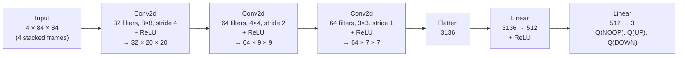
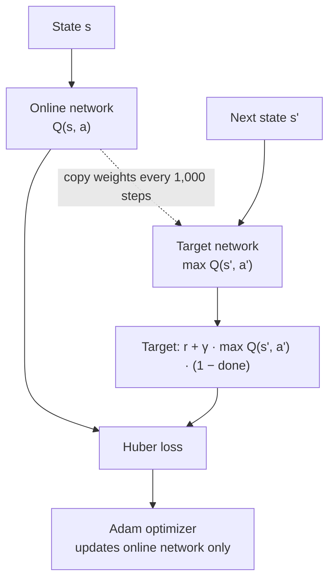
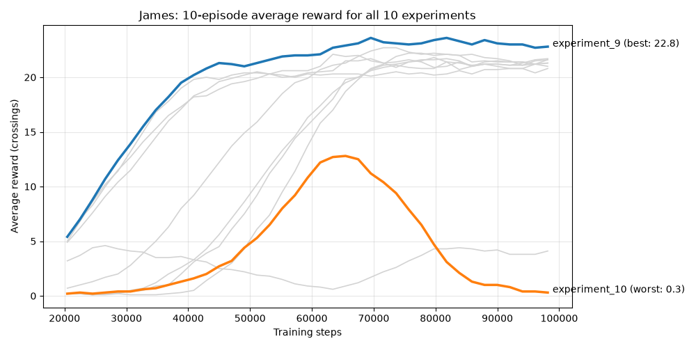
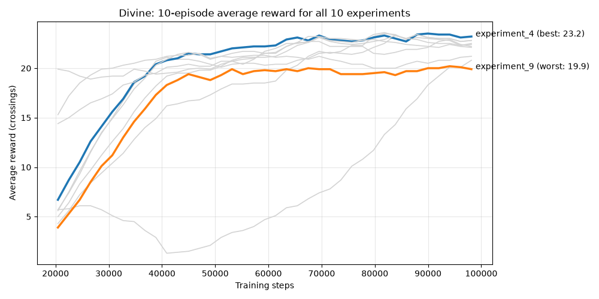
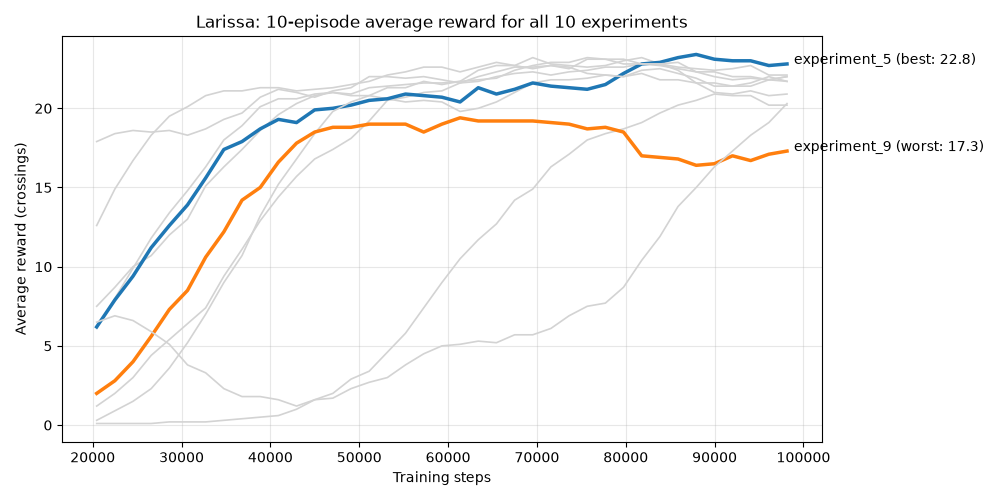
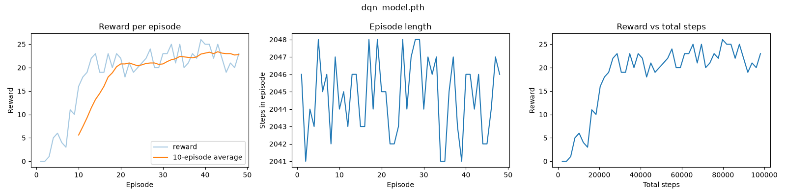

# Deep Q-Learning on Atari Freeway


## Project Introduction

This project trains a Deep Q-Network (DQN) agent to play the Atari game **Freeway** using PyTorch and Gymnasium. The DQN is written from scratch: the convolutional network, replay buffer, epsilon-greedy exploration, target network and training loop are all our own code. No ready-made reinforcement learning library (Stable-Baselines3, RLlib, CleanRL, TorchRL) is used.

Each group member ran 10 hyperparameter experiments. The best configuration was used to train the final model, `dqn_model.pth`, which `play.py` loads to show the agent playing in real time.

## Group Members

| Member | Contribution |
|---|---|
| Mukunzi Ndahiro James | Environment setup, `train.py`, 10 hyperparameter experiments, final model |
| Divine Itu | 10 hyperparameter experiments |
| Larissa Inyange | 10 hyperparameter experiments, `play.py` |

See the [Task allocation sheet](Task%20allocation%20sheet.pdf) for the full division of work and our meeting log.

## Selected Atari Environment

**Freeway** (`ALE/Freeway-v5`)

The player controls a chicken that must cross a ten-lane highway full of moving cars. Each time the chicken reaches the top, the agent gets **+1 reward** and the chicken starts again at the bottom. If a car hits the chicken, it is pushed back down a lane. A game lasts about 2 minutes 16 seconds (around 2,045 agent steps), and the goal is to cross as many times as possible.

- **Actions (3):** NOOP (stay), UP, DOWN
- **Reward:** +1 per successful crossing, 0 otherwise
- **Reference scores:** random play gets about 0 crossings; pressing UP the whole game gets about 21

### Preprocessing (`atari_env.py`)

| Step | Setting |
|---|---|
| Frame skip | The chosen action is repeated for 4 frames |
| Grayscale | Colour frames are converted to one channel |
| Resize | Frames are resized to 84 × 84 pixels |
| Frame stack | The last 4 frames are stacked so the network can see movement |

The network input is therefore a `4 × 84 × 84` tensor.

## DQN Architecture

The Q-network (`model.py`) is the convolutional network from the original DQN paper (Mnih et al., 2015). It takes the 4 stacked frames and outputs one Q-value per action.



| Layer | Details | Output shape |
|---|---|---|
| Input | 4 grayscale frames, pixel values divided by 255 | 4 × 84 × 84 |
| Conv 1 | 32 filters, 8×8 kernel, stride 4, ReLU | 32 × 20 × 20 |
| Conv 2 | 64 filters, 4×4 kernel, stride 2, ReLU | 64 × 9 × 9 |
| Conv 3 | 64 filters, 3×3 kernel, stride 1, ReLU | 64 × 7 × 7 |
| Flatten | | 3136 |
| Fully connected | 3136 → 512, ReLU | 512 |
| Output | 512 → number of actions | 3 |

### Online and Target Networks

Two copies of this network are used:



- The **online network** chooses actions and is updated by gradient descent.
- The **target network** computes the Bellman targets. It is a frozen copy that is only refreshed every 1,000 steps, which keeps the targets stable while the online network learns.

## Training Process

Training is done by `train.py`. Each step works like this:

1. **Choose an action with epsilon-greedy.** With probability ε the agent picks a random action (exploration); otherwise it picks the action with the highest Q-value from the online network (exploitation). ε decreases linearly from `eps_start` to `eps_end` over `eps_decay` steps, then stays at `eps_end`.
2. **Act in the environment** and observe the reward, the next state and whether the game ended.
3. **Store the experience** `(state, action, reward, next_state, done)` in the **replay buffer** (`replay_buffer.py`), which holds the most recent 50,000 experiences.
4. **Learn from a random batch.** After 10,000 steps of collecting experience, every 4 steps a random batch is sampled from the buffer. Random sampling breaks the correlation between consecutive frames.
   - The online network predicts **Q(s, a)** for the actions that were taken.
   - The target network gives the **Bellman target**: `y = r + γ · max Q_target(s', a') · (1 − done)`.
   - The loss is the **Huber (smooth L1) loss** between Q(s, a) and y.
   - **Backpropagation** computes the gradients, which are clipped to a maximum norm of 10, and the **Adam** optimizer updates the online network.
5. **Update the target network** by copying the online network's weights every 1,000 steps.

`done` is only true when the game actually ends (`terminated`), so the agent does not treat a time-limit cut-off as the end of the future rewards.

At the end of training, the script saves the model, a CSV log of every episode (length, total steps, reward, epsilon, loss) and a training plot.

### Fixed Settings

| Setting | Value |
|---|---|
| Total training steps | 100,000 |
| Replay buffer size | 50,000 |
| Learning starts after | 10,000 steps |
| Train every | 4 steps |
| Target network update | every 1,000 steps |
| Optimizer | Adam |
| Loss | Huber (smooth L1) |
| Gradient clipping | max norm 10 |
| Seed | 42 |

## Hyperparameter Experiments

Each member ran 10 experiments, each with a different combination of learning rate, gamma, batch size, epsilon start, epsilon end and epsilon decay. **Score** is the mean number of crossings over the final 10 training games.

| Member | Results table | Best experiment | Worst experiment |
|---|---|---|---|
| James | [James_Hyperparameter_experiment_results.md](James_Hyperparameter_experiment_results.md) | Exp 9: γ 0.95, score 22.8 | Exp 10: learning rate 0.00001, score 0.3 |
| Divine | [Divine_Hyperparameter_experiment_results.md](Divine_Hyperparameter_experiment_results.md) | Exp 4: γ 0.8, score 23.2 | Exp 9: ε end 0.1, score 19.9 |
| Larissa | [Larissa_Hyperparameter_experiment_results.md](Larissa_Hyperparameter_experiment_results.md) | Exp 5: γ 0.5, score 22.8 | Exp 9: ε end 0.2, score 17.3 |





### Main Findings

- **Epsilon end mattered most for the final score.** Leaving 10–20% random actions until the end of training cost 3–5 crossings, because a random DOWN or wait at the wrong moment gets the chicken hit.
- **Shorter exploration made learning faster.** Epsilon decay over 15,000–25,000 steps reached 15+ crossings much earlier than decay over 50,000–75,000 steps.
- **A lower gamma worked well.** Freeway rewards every crossing, so the agent does not need to plan far ahead. Gamma between 0.5 and 0.95 scored better than 0.99.
- **The learning rate had to be large enough.** 0.0005–0.003 was stable; 0.00001 never learned.

## Final Model

The final model, `dqn_model.pth`, was trained with the best configuration from the experiments (Divine's experiment 4):

| Learning rate | Gamma | Batch size | Epsilon start | Epsilon end | Epsilon decay |
|---|---|---|---|---|---|
| 0.001 | 0.8 | 32 | 1.0 | 0.01 | 25,000 |

Training performance of the final model:

- **Episodes:** 48 (98,149 steps)
- **Episode length:** about 2,045 steps (Freeway games run on a timer)
- **Score:** 22.8 crossings (mean of the final 10 games), best game 26
- **First game with 15+ crossings:** step 20,446



The full episode log is in `logs/dqn_model.csv`.

## Gameplay Demonstration

**Video:** [Watch the trained agent play Freeway (Loom)](https://www.loom.com/share/f8b0bd4b2b584ca5b327acbaefac31cc)

The video shows the final agent (`dqn_model.pth`) playing Freeway with greedy actions through `play.py`. It scores about 21 crossings per game, compared with about 0 for a random agent.

## How to Run

This project uses [uv](https://docs.astral.sh/uv/) for the Python environment and packages.

```bash
# Install dependencies
uv sync

# Train with the default settings (saves dqn_model.pth)
uv run train.py

# Train with the final configuration
uv run train.py --lr 0.001 --gamma 0.8 --batch_size 32 --eps_start 1.0 --eps_end 0.01 --eps_decay 25000

# Run one experiment for a member (saves to models/<member>/experiment_<n>.pth)
uv run train.py --member James --experiment 1 --lr 0.0001 --gamma 0.99

# Watch the trained agent play
uv run play.py
uv run play.py --model models/Divine/experiment_4.pth --episodes 3
```

## Repository Structure

```
├── train.py                 # DQN training loop
├── play.py                  # Loads dqn_model.pth and plays with greedy actions
├── model.py                 # Q-network (CNN)
├── replay_buffer.py         # Experience replay buffer
├── atari_env.py             # Freeway environment and preprocessing
├── dqn_model.pth            # Final trained model
├── models/<member>/         # One model per experiment for each member
├── logs/<member>/           # Episode logs and settings for each experiment
├── plots/<member>/          # Training plot for each experiment
├── plots/<member>_experiments.png   # All 10 experiments of each member on one chart
├── <Member>_Hyperparameter_experiment_results.md
├── Task allocation sheet.pdf
├── pyproject.toml
└── uv.lock
```
